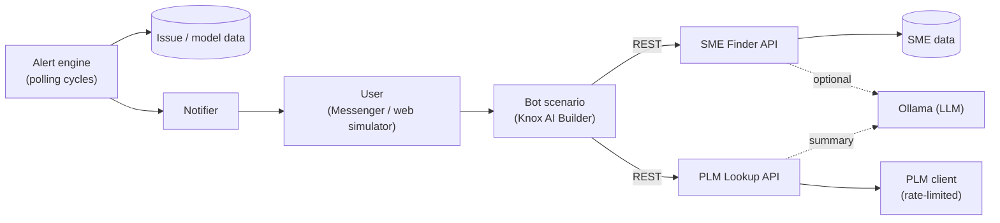

<div align="center">

# MQL_PLMate

**AI-powered messenger bot for expert search, PLM issue lookup, and automated issue alerts**


[](https://github.com/Jaymun0812/qa-assistant-bot/actions/workflows/tests.yml)

</div>

---

MQL_PLMate is a Knox Messenger bot I built for my QA team. Engineers can find the right subject matter expert and check PLM issue details without leaving the messenger, while issues that need attention are pushed to the responsible owners automatically.

> **About this repository.** The production bot runs against internal systems (the PLM system, SQL Server, and the messenger notification API). This repository is a **public, offline re-implementation** of the same three services, backed by mock data, so anyone can run it, call the APIs, and read the tests. All names, IDs, and models in the data are fictional.

## ▶️ Quick Start

```bash
pip install -r requirements-demo.txt

python -m uvicorn mqlbot_demo.app:app                 # bot simulator at http://localhost:8000
python -m mqlbot_demo.alerts --now 2026-11-10T09:00   # alert engine: two polling cycles
pytest --cov=mqlbot_demo                              # test suite
```

API docs are available at `http://localhost:8000/docs` while the server is running. See the [Demo Guide](docs/DEMO.md) for things to try.

## 📋 Features

| Feature | What it does | Guide |
| --- | --- | --- |
| **SME Finder** | Finds in-team subject matter experts (SMEs) by technical keyword | [SME Finder](docs/SME_FINDER.md) |
| **PLM Issue Lookup** | Shows issue details by PLM number, with Korean/English summaries | [PLM Issue Lookup](docs/PLM_ISSUE_LOOKUP.md) |
| **PLM Issue Alert** | Notifies owners about new, resolved, and reopened issues based on rules | [PLM Issue Alert](docs/PLM_ISSUE_ALERT.md) |

## ✨ Highlights

- **Three services, one bot** — SME search, issue lookup, and rule-based alerting delivered through a single messenger bot built on Knox AI Builder.
- **Hybrid search** — Keyword scoring across expertise, keyword, and coverage fields, with optional LLM query expansion when keyword search returns nothing.
- **Bilingual summaries** — Issue symptom, cause, and countermeasure summarized in Korean and English, using a local LLM (Ollama) with a deterministic offline fallback.
- **Readable issue cards** — HTML-heavy PLM content (tables, lists, kernel logs) cleaned and truncated to fit Adaptive Cards.
- **Reliable alerting** — Five alert categories with per-owner grouping, persistent deduplication, retry after failed sends, and atomic history writes.
- **Built to be tested** — Time-injected pure rules, a pluggable notifier, and a rate limiter with an injectable clock; ~100 pytest cases with CI on every push.

## 🏗️ Architecture



| Component | Demo module | In production |
| --- | --- | --- |
| SME Finder | `sme_search.py`, `sme_api.py` | Same scoring, data in SQL Server |
| PLM Issue Lookup | `plm_lookup.py`, `plm_client.py`, `plm_api.py` | PLM system API |
| AI Summary | `summarizer.py` | Local Ollama model |
| Issue Alert | `alerts/` | SQL Server polling, messenger notification API |
| Bot UI | `static/index.html` (simulator) | Knox AI Builder scenarios and Adaptive Cards |

## 🛠️ Tech Stack

- **Backend:** Python, FastAPI, Uvicorn, Pydantic v2, httpx, BeautifulSoup4
- **AI:** Ollama (local LLM) for query expansion and summarization
- **Testing:** pytest, pytest-cov, FastAPI TestClient, GitHub Actions (Python 3.10–3.12)
- **Bot platform (production):** Knox Messenger, Knox AI Builder (Workflow, Adaptive Cards, Notification Open API), SQL Server

## 🧪 Testing

```bash
pytest --cov=mqlbot_demo --cov-report=term-missing
```

The suite focuses on the conditions that matter in QA work: boundary values (exactly 7 days, a 14- vs 15-day Sign Off window, 10:59 vs 11:00, weekends), deduplication across cycles and restarts, retries after failed sends, corrupted history files, and partial results when an upstream service fails. CI runs the tests and the alert demo on every push.

## 📂 Repository Structure

```text
.
├── README.md
├── requirements-demo.txt
├── pytest.ini
├── .github/workflows/tests.yml      # CI: tests on Python 3.10–3.12
├── mqlbot_demo/
│   ├── app.py                       # Server: SME Finder + PLM Lookup + web UI
│   ├── sme_search.py                # SME scoring and ranking
│   ├── sme_api.py                   # SME Finder endpoints
│   ├── plm_client.py                # Mock PLM client + rate limiter
│   ├── plm_lookup.py                # Issue normalization and response shaping
│   ├── plm_api.py                   # Issue Lookup and summary endpoints
│   ├── summarizer.py                # Ollama summary with rule-based fallback
│   ├── text_utils.py                # HTML cleanup and log truncation
│   ├── alerts/                      # Rule-based alert engine and CLI
│   ├── data/                        # Mock SMEs, PLM issues, alert scenario
│   └── static/index.html            # Chat-style bot simulator
├── tests/                           # pytest suite
└── docs/
    ├── DEMO.md                      # What to try, alert scenario, design choices
    ├── SME_FINDER.md
    ├── PLM_ISSUE_LOOKUP.md
    ├── PLM_ISSUE_ALERT.md
    └── KNOX_BOT_TUTORIAL.md         # How the services plug into Knox AI Builder
```

## 📖 Glossary

- **SME (Subject Matter Expert):** A team member responsible for a specific technical area.
- **PL Lead:** The owner mapped to a model/project who receives its alerts.
- **Resolve:** An issue status indicating a fix has been applied and is awaiting verification.
- **Reopen:** An issue whose previously recorded `Resolve` status has changed back to `Open`.
- **Sign Off:** The release approval milestone of a model.
