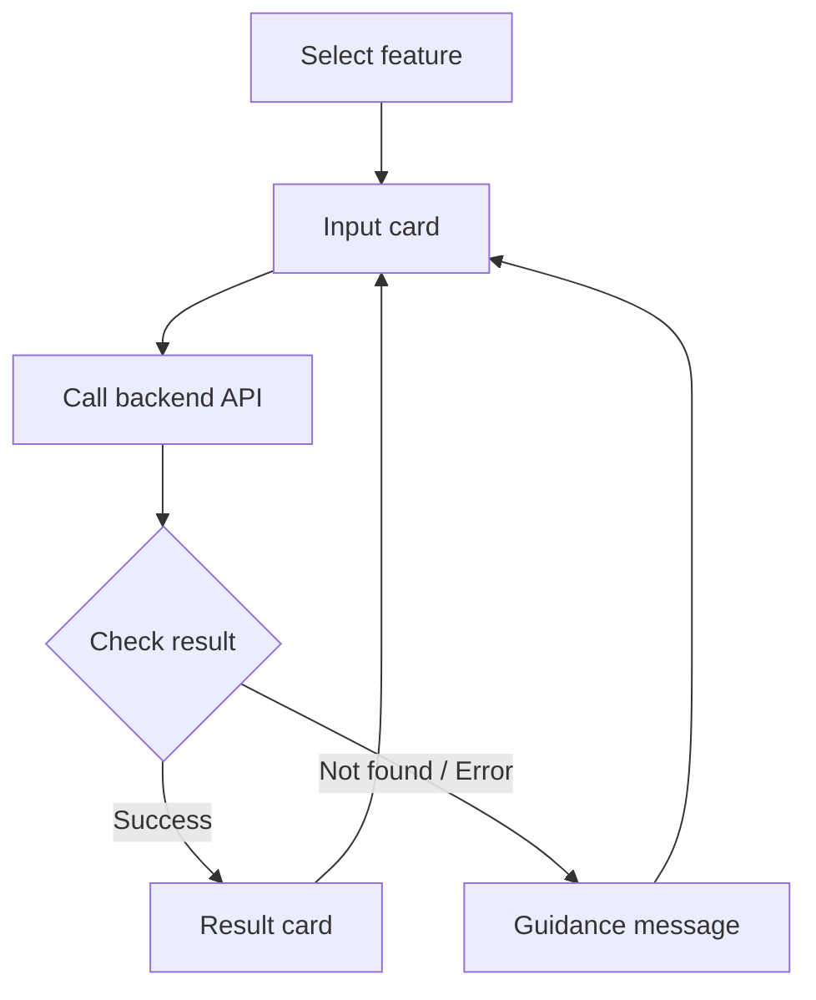

# Knox Bot Integration Guide

[Back to overview](../README.md)

**This guide summarizes how MQL_PLMate is built on Knox AI Builder: preparing the bot account, connecting input cards to backend APIs, and testing and deploying.** It explains how SME search, PLM lookup, and automated alerts fit together in the platform.

> Based on the Knox AI Builder Tutorial (v1.0). Menus and procedures may differ from the current service; refer to the official documentation for up-to-date details. Request and response examples match the APIs in [`mqlbot_demo/`](../mqlbot_demo).

## 1. Core Components

| Component | In plain terms | Role in MQL_PLMate |
| --- | --- | --- |
| Knox Bot account | The bot account users meet in the messenger | Bot ID and display name |
| AI Builder | Tool for building the bot's UI, conversations, and flows | Feature entry points, input/output cards, API calls |
| Scenario / Workflow | The sequence executed in response to user actions | Input → API → result or error message |
| App Card | Screen with input fields, buttons, and results | Keyword input, issue number input, result display |
| Backend API | Server that performs the actual data processing | SME search (`sme_api.py`), PLM lookup (`plm_api.py`) |
| Notification Open API | Path for external programs to message users | Automated alerts (`alerts/`; the demo prints to the console instead) |

Building screens in AI Builder does not create the Python servers or databases. The runtime environment, network access, and data are prepared separately.

## 2. Setting Up the Bot and Test Environment

1. Request a bot account in Knox Dev Center and confirm approval.
2. Request stage bot integration.
3. Create the bot in AI Builder, linking the messenger environment and the bot's Knox ID.
4. Develop and verify features on stage.
5. Prepare the production integration with production bot settings.

Stage integration must be completed before requesting production integration, and bot integration is required to deploy to the messenger. Note that the bot name inside AI Builder may differ from its display name in Knox Messenger, so keep track of the bot ID as well.

Generative AI content features require separate Copilot access. MQL_PLMate's keyword search and backend API calls do not fall under this category.

## 3. Connecting Input Cards and APIs with Workflow

A Workflow chains text, app card, API, and condition components. A typical MQL_PLMate flow looks like this:



### Turning Inputs into Variables

Assign an `id` to each app card input and reference it as a variable in later steps. Example for a PLM issue number:

```json
{
  "type": "Input.Text",
  "id": "issueNumber",
  "placeholder": "Enter a PLM issue number."
}
```

API responses can also be stored as user variables. Direct references to an API response are scoped only up to the next app card, so **store any result you need across multiple steps in a user variable**.

The menu path is `Bot → target bot → Workflow → Register`. Connect the components, save, and verify with Test. Then attach the completed Workflow to a scenario and deploy. App cards and APIs edited inside a Workflow are not automatically synced to the same items elsewhere.

## 4. Lookup Feature Integration

### SME Finder

| Step | Configuration |
| --- | --- |
| Input | Receive the search keyword as `query` |
| API | Call `POST /api/find-sme` on the SME server |
| Request | Send `query`, `top_k`, and optionally `team_filter` |
| Response | Check `total_count`, then display `formatted_result` or candidate fields |
| No results | Suggest trying another keyword or team filter |

`${query}` is the input variable bound in the Workflow and replaced with the user's value at request time.

```json
{
  "query": "${query}",
  "top_k": "all",
  "team_filter": null
}
```

Displaying `formatted_result` adapts automatically to the number of matches. For individual cards, use `candidates` or flattened fields such as `candidate1_name`.

Details: [SME Finder](SME_FINDER.md).

### PLM Issue Lookup

| Step | Configuration |
| --- | --- |
| Input | Receive the issue number as `issueNumber` |
| API | Call `POST /api/aibuilder/issue-lookup` on the PLM lookup server |
| Response | Check HTTP errors, `resultCode`, and `output.found` |
| Output | Bind title, status, description, cause, countermeasure, and comment to the card |

```json
{
  "issueNumber": "${issueNumber}"
}
```

The lookup API returns **data**; the Adaptive Card JSON and variable mapping are configured in Builder. When `output.found=false`, branch to a "please check the number" message instead of showing the result card.

To add a summary, call `POST /api/aibuilder/ai-summary` after the lookup, passing at least 50 characters of body text in `text`, plus cause and countermeasure if available. Show the generated summary alongside the original text.

Details and card example: [PLM Issue Lookup](PLM_ISSUE_LOOKUP.md).

## 5. Automated Alerts

AI Builder supports both registering alerts in its UI and calling the Notification Open API from an external system. **MQL_PLMate uses the Open API from an external program.**

1. Prepare the target bot ID and environment for the Notification API.
2. Query alert targets from the internal database and determine recipients.
3. Call the Notification API.
4. Check the send response, program logs, and history.

Example text message payload (placeholder values):

```json
{
  "botEnv": "stage",
  "contentsType": "text",
  "botId": "<BOT_ID>",
  "targetUserId": "<TEST_USER_ID>",
  "subject": "PLM Test Alert",
  "contents": "Please confirm you received this test message."
}
```

Text and app card alerts use different payloads. Since the current code uses `contentsType="text"`, no app card ID is required.

Alert conditions, recipients, and schedule are determined by the Python program, not by Builder's alert scheduling. Deploying the bot/Workflow and sending alerts through the API are independent.

Details: [PLM Issue Alert](PLM_ISSUE_ALERT.md).

## 6. Save, Test, Deploy, Operate

| Step | What to verify |
| --- | --- |
| Save | Workflow, card, and API changes are saved |
| Simulator | Input → API → result/error branches behave correctly |
| Stage messenger | Card rendering, buttons, and delivery work on the real bot account |
| Production deploy | Production bot, server URL, and recipients are configured correctly |
| Production check | Success, not-found, and API failure cases are handled distinctly |
| Monitoring | Builder usage logs are reviewed together with Python, DB, and alert logs |

Test runs against the saved Workflow, so save after every edit. Some feedback behaviors cannot be verified in the simulator alone, so also test in the stage messenger. When searching for the bot in the messenger, check the bot ID and registered name in Dev Center, not just the management name in AI Builder.

## 7. Troubleshooting

| Symptom | Check first |
| --- | --- |
| Bot not found in messenger | Bot account / integration approval, stage vs. production, registered name and ID |
| Changes not reflected | Save, scenario attachment, deployment, target bot |
| `${variable}` shown literally on the card | Input id, response path, variable storage and scope |
| API step fails | Server address, network, request body, timeout |
| Result lost in later steps | Whether the value was saved to a user variable |
| Some users can't use the bot | Bot usage permissions and data access |
| Missing automated alert | DB updates, Python target conditions, recipient mapping, send history |
